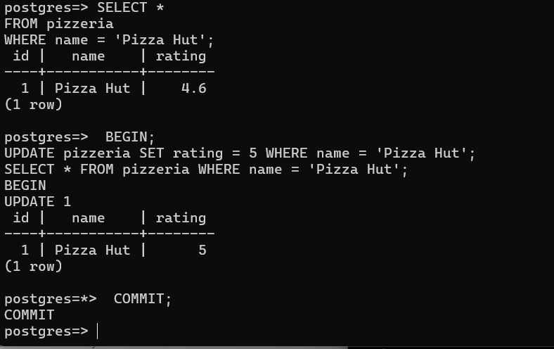
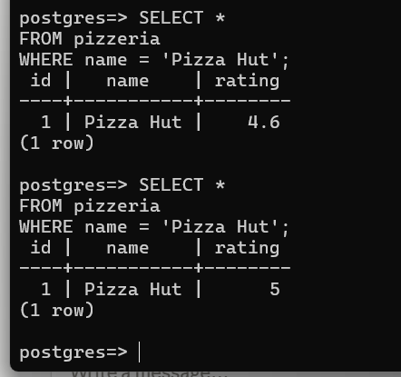
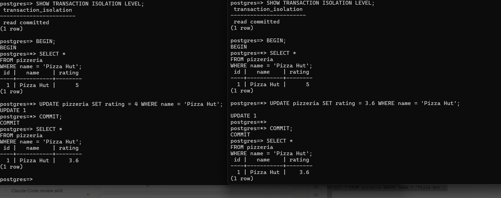
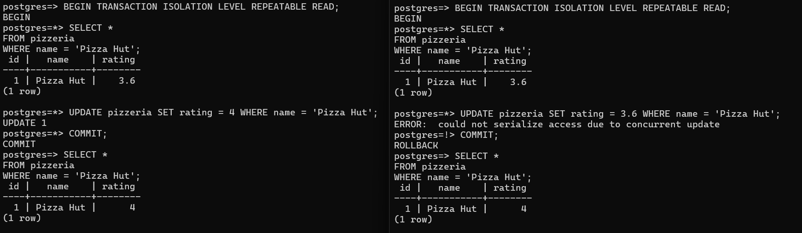
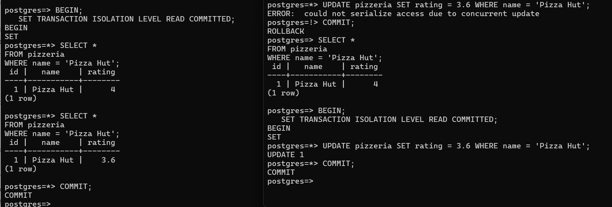
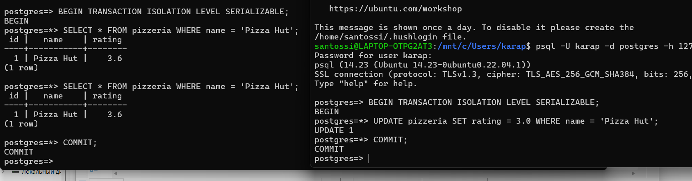
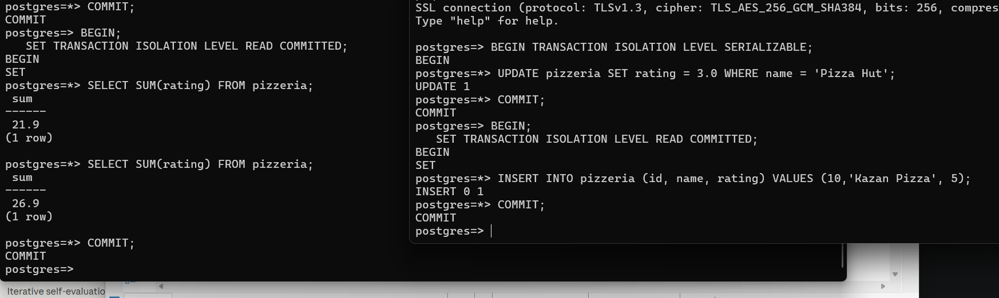
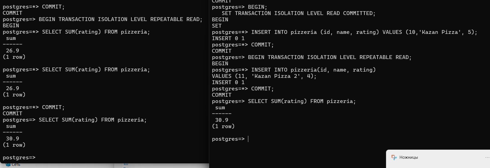
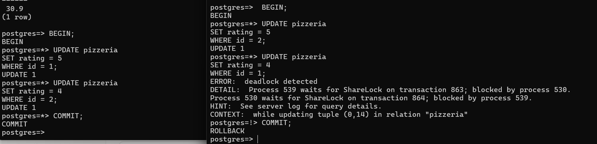

# SQLB10 — Уровни изоляции транзакций

**Темы:** аномалии параллельных транзакций в двух сессиях psql: lost update, non-repeatable read, phantom read и deadlock при READ COMMITTED, REPEATABLE READ и SERIALIZABLE. Скриншоты сессий приложены.

PostgreSQL. Учебная база: пиццерии, посетители, меню и заказы (схема — в [SQLB01](../SQLB01_Basics/model.sql)).

## Решения

- [ex00/day08_ex00.sql](ex00/day08_ex00.sql)

- [ex01/day08_ex01.sql](ex01/day08_ex01.sql)

- [ex02/day08_ex02.sql](ex02/day08_ex02.sql)

- [ex03/day08_ex03.sql](ex03/day08_ex03.sql)

- [ex04/day08_ex04.sql](ex04/day08_ex04.sql)

- [ex05/day08_ex05.sql](ex05/day08_ex05.sql)

- [ex06/day08_ex06.sql](ex06/day08_ex06.sql)

- [ex07/day08_ex07.sql](ex07/day08_ex07.sql)

---
[← Ко всем проектам](../README.md)
